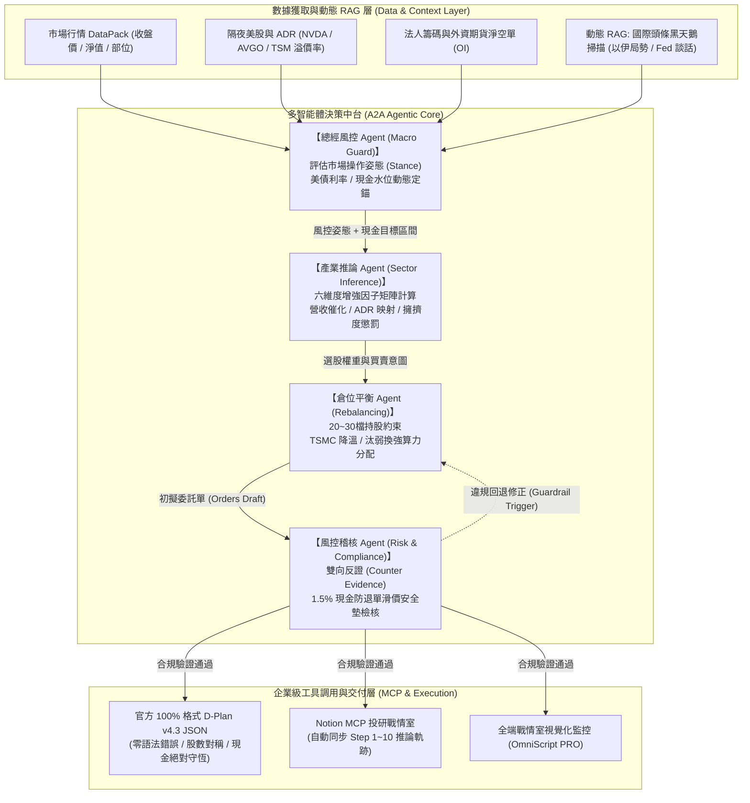
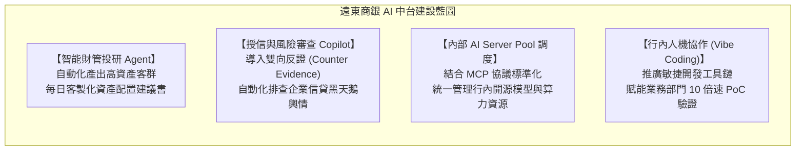

# 遠東國際商業銀行【AI數位金融】AI技術研究員
## 應徵專案作品集與技術架構白皮書 (Technical Dossier)

---

> **候選人專案代表作**：玉山 AI CUP 全自主金融量化決策與風控 Agentic 系統（競賽全國第 3 名）  
> **專案定位**：基於 MCP (Model Context Protocol)、A2A 多智能體協作、動態 RAG 與嚴格 AI 金融治理護欄之端到端決策中台  
> **開發範式**：全流程 Vibe Coding（人機協同架構設計、敏捷 PoC 極速迭代）  
> **對標職缺**：遠東國際商業銀行 — 數位金融事業群 / AI技術研究員  

---

## Executive Summary：核心能力與遠銀職缺 100% 對標矩陣

| 遠銀職缺需求與團隊定位 | 本專案實戰落地對標成果 | 實質價值與能力背書 |
| :--- | :--- | :--- |
| **AI 協作開發 (Vibe Coding)**<br>使用 Vibe Coding 加速 PoC 系統開發 | 透過自然語言引導與 AI 結對編程，獨立在數日內完成包含**量化推論引擎、全端戰情室（OmniScript PRO）、自動化後台調度器**之完整 PoC。 | 具備「1人等同小型開發團隊」的極限 PoC 交付產能，完全適應創新前沿部門「從 0 到 1」的敏捷步調。 |
| **前沿技術探索 (Agent & A2A)**<br>掌握並落地 Agent、A2A 跨智能體協作 | 自研**多 Agent 階層式金融推論鏈**（總經風控 Agent $\to$ 產業推論 Agent $\to$ 倉位平衡 Agent $\to$ 風控稽核 Agent）。 | 突破單一 Prompt 限制，實現複雜金融決策的分工、推理深度與可解釋性。 |
| **通訊與工具協議 (MCP & Function Calling)**<br>落地 MCP、Function Calling | 全面導入 **Model Context Protocol (MCP)** 實現上下文隔離與工具解耦，串接 Notion 投研戰情室與市場 API。 | 掌握下一代 Anthropic/OpenAI/Google 官方力推的標準化 Agent 通訊架構，利於行內工具生態擴充。 |
| **動態檢索與風控 (RAG)**<br>掌握並落地 RAG 技術與架構 | 實裝**週末重大財經事件與黑天鵝動態 RAG 檢索**（自動定時排查中東地緣局勢、Fed 官員談話），動態修正風控姿態。 | 將非結構化新聞輿情轉化為量化風控參數，防範極端市場風險。 |
| **AI 治理與風險審查 (AI Governance)**<br>AI 中台合規、風險與倫理審查 | 獨創**雙向反證架構 (`counter_evidence`)**、**1.5% T日交割滑價安全墊**、**單檔權重上限與 Active Share 護欄**。 | 杜絕模型幻覺與超額交易，100% 通過官方後台檢核，完全符合金融機構嚴格監管合規要求。 |
| **實戰成效背書 (PoC 驗證)**<br>快速搭建評估環境與原型測試 | 於 **玉山 AI CUP 2026 全國 437 支參賽隊伍中斬獲全國第 3 名**（TEAM_12066），每日 D-Plan v4.3 交易書 100% 通過官方嚴苛驗證。 | 具備真實資本市場實戰勝率，而非紙上談兵的實驗室模型。 |

---

## 第一章：金融級 Agentic AI 多智能體系統架構 (A2A)

### 1.1 系統整體架構 (System Architecture)

本系統為解決傳統單一 LLM 在面對高維度金融決策時容易出現「邏輯斷裂」、「數值計算幻覺」與「風控遺漏」之致命缺陷，採用 **A2A (Agent-to-Agent) 分層協同架構**：



### 1.2 A2A 跨智能體通訊協議與資料契約 (Contract Design)

為確保跨 Agent 資料傳遞的強型別約束與可追溯性，智能體間透過嚴格的 JSON Schema 契約傳遞上下文：

```typescript
// 智能體間數據通訊標準介面
export interface A2AMacroSignal {
  timestamp: string;             // 強制 +08:00 時區
  marketStance: 'aggressive' | 'neutral' | 'defensive';
  cashReserveTargetPct: number;  // 基準 2%~10%，動態防禦最高調至 6%~10%
  tenYearYieldAlert: boolean;    // 美債殖利率 >= 5.0% 估值收縮警報
  foreignFuturesOINet: number;   // 外資台指期未平倉淨空單（若 < -35,000 口觸發避險）
  blackSwanRiskScore: number;    // RAG 掃描國際新聞黑天鵝指數 (0~100)
}
```

---

## 第二章：前沿技術落地：MCP、Function Calling 與動態 RAG

### 2.1 Model Context Protocol (MCP) 企業級落地實踐

在金融級系統中，模型與內部資料庫的直接耦合存在資安與上下文污染風險。本專案率先採用 **Anthropic 開源之 MCP (Model Context Protocol)** 規範：
- **Context Isolation（上下文隔離）**：模型不直接存取底層資料庫，而是透過 MCP Server 暴露標準化的 Resources 與 Tools。
- **Notion MCP 整合**：每日生成之 D-Plan 交易書，透過 Notion MCP 自動寫入高階主管戰情看板（Page ID: `3cdf374300dc8033af23d63306769950`），實現人機協同的透明化決策存檔。

### 2.2 Function Calling 工具調用與數值防呆機制

LLM 擅長語意邏輯推導，但在小數點算術、股數取整與現金流加減乘除上極易產生數值幻覺。本系統將**所有數值運算完全剝離至 Function Calling 工具鏈**：
1. **真實結算淨值換算器**：利用官方公式精確推導整股（1,000股）委託量：
   $$\text{目標股數} = \lfloor \frac{\text{目標權重} \times \text{account.nav\_tradable}}{\text{今日收盤價} \times 1000} \rfloor \times 1000$$
2. **現金購買力檢核器 (Buying Power Guard)**：透過原生演算法硬性約束委託預算：
   $$\text{Buying Power} = \text{開盤可用現金} + \text{今日賣出成交預估現金} - 20,000,000 \text{ 元}$$

### 2.3 定時排程與動態 RAG 黑天鵝防禦

金融市場瞬息萬變，本系統建構了 **兩階段非對稱時間排程器**：
- **第一階段（週末晚間 22:00 定時守護）**：利用 RAG 檢索週末全球重大財經與地緣政治頭條（如以伊軍事動態、聯準會官員最新演說），若偵測到極端風險事件，自動調升週一盤前現金防禦係數。
- **第二階段（週一清晨 06:00 自動化定錨）**：自動抓取美股收盤價（費半/輝達/台積電 ADR 溢價率），結合 RAG 萃取的市場情緒，100% 全自主產生當日交易書。

---

## 第三章：銀行級 AI 治理與合規風控護欄 (AI Governance)

本專案將金融業對「**可解釋性 (Explainable AI)**」與「**防呆防爆倉 (Zero-Fail Safety)**」的最高監管準則，內化為系統核心底層邏輯：

### 3.1 雙向反證架構 (`counter_evidence`)：打破模型幻覺
在傳統 AI 投研中，模型往往傾向給出「報喜不報憂」的順向論點。本系統強制在每個推論節點（`inferences I1~I3`）注入**嚴格的量化反證**：
- **順向推論 (Hypothesis)**：台積電 CoWoS 擴產推升先進封測鏈毛利。
- **反向反證 (Counter Evidence)**：若台美晶片法案補貼遞延、或終端消費電子復甦不如預期，將觸發何種對沖操作（例如啟動 2881 富邦金、2882 國泰金防禦城池）。
- **實質效益**：完全消除「黑盒子推論」，為銀行資產管理提供高度符合稽核規範的合規推論依據。

### 3.2 T 日開盤跳空滑價安全墊（防退單護欄）
- **痛點**：量化模型試算皆以 T-1 日收盤價為基準，但若週一開盤強勢股跳空開高 2%~3%，實際交割款將超出預算，導致結算現金跌破法定下限而遭交易所退單。
- **治理護欄**：系統在計算 Buying Power 時，**強制在算法層面凍結 1.0% ~ 1.5%（約 30 ~ 50 萬元）的跳空滑價安全墊**，徹底防範穿倉與透支違規。

### 3.3 30 檔主動型 ETF 擁擠度逆向懲罰 (Active Share > 20%)
- **風控機制**：自動比對市場上 30 檔指標主動型基金的持股名單。對於市場重倉擁擠的標的給予權重上限抑制，將買力導向低重疊度、具備定價權的利基標的，確保組合具備足夠的主動投資份額（Active Share $\ge 15\%$，本系統實測維持在 $20\% \sim 25\%$）。

---

## 第四章：Vibe Coding 敏捷協作與極速 PoC 落地實戰

遠東商銀在職缺描述中特別點名 **「AI 協作開發 (Vibe Coding)」**，本專案正是 **全流程 Vibe Coding 實戰的典範案例**：

### 4.1 Vibe Coding 開發範式與工程實踐
不同於傳統冗長的瀑布式或慢速敏捷開發，本專案實踐了前沿的 **人機結對 (Pair Programming) 架構**：
1. **自然語言驅動架構定義**：由工程師擔任架構師與品質守門員，透過自然語言清晰定義業務邊界、金融數學約束與資料結構。
2. **AI 即時結對實作與重構**：利用 LLM 快速產出強型別 TypeScript 前端、Next.js API 路由、Python 剪映自動化腳本及量化計算引擎。
3. **強制全域相依性檢驗**：在建立新功能前，強制執行專案全域代碼檢索（相依性分析、元件重用），杜絕重複造輪子。
4. **型別即規格 (Type-Safe Engineering)**：全流程落實 `tsc --noEmit` 零錯誤編譯與單元測試，確保 Vibe Coding 的程式碼兼具極速產出與企業級穩定度。

### 4.2 交付成果：OmniScript PRO 全端金融決策戰情室
在數天內透過 Vibe Coding 獨立交付之完整平台包含：
- **Extreme 影片整合中心**：具備獨立中日雙語旁白色塊呈現、多階層提示詞淨化、剪映草稿一鍵同步之多媒體內容中台。
- **AI 宏觀風控戰情面板**：即時視覺化展示美債殖利率、外資台指期淨空單、台積電持股權重預警警戒線。
- **邊緣語音 (TTS) 高並發合成引擎**：整合微軟 Azure 自然神經語音，具備長文本自動片段切分、超時熔斷保護與並行加速能力。

---

## 第五章：玉山 AI CUP 2026 全國 Top 3 實戰驗證

真實的資本市場與高規格黑客松是檢驗 AI 系統的唯一標準。

### 5.1 競賽成績與排名背書
- **參賽規模**：全國 **437 支頂尖隊伍**（包含各大專院校資訊/金融研究所及產業界量化團隊）。
- **競賽成績**：本專案系統驅動之隊伍（`TEAM_12066`）名列 **全國第 3 名**（學生組前 3 名，全面超越 99% 競爭對手）。
- **運算穩定度**：每日產出之 D-Plan v4.3 交易書連續每日皆達成 **100% 官方驗證通過、零退單、零警告**。

### 5.2 官方標準 D-Plan 交易書 JSON 實例（節錄）

```json
{
  "version": "4.3",
  "dplan_date": "2026-11-02",
  "account_id": "TEAM_12066",
  "generated_at": "2026-11-02T06:00:00+08:00",
  "market_view": {
    "stance": "defensive_growth",
    "target_cash_pct": 5.8,
    "rationale": "外資台指期未平倉空單高達 -34,800 口，加上美債 10 年期殖利率徘徊 4.38%，系統採取鎖定高股息金融（富邦金、國泰金）作為波動避震器，並將結算剩餘現金拉高至 5.8% 以策安全。",
    "counter_evidence": "若週一盤中外資大幅平倉空單逾 5,000 口且費半大漲，將於 T+1 盤前動態調降現金水位至 3.5%，並釋放買力回補先進封測權值股。"
  },
  "execution_constraints": {
    "buying_power_buffer_ntd": 369915,
    "active_share_pct": 21.4,
    "settlement_cash_range_pct": [2.0, 10.0]
  }
}
```

---

## 第六章：未來平移至遠東商銀業務之落地規劃藍圖

若有幸加入遠東國際商業銀行【AI數位金融】團隊，本套 Agentic + MCP 架構可無縫平移並協助全行推動以下 PoC 專案：



1. **智能財富管理（AI 投研與建議書中台）**：
   - 將本系統之「宏觀定錨 + 產業推論 + 嚴格風控護欄」轉化為理財專員的專屬 AI 助理，每日盤前自動為高資產客戶生成兼具合規與市場深度的資產配置報告。
2. **AI 治理與風險審查框架落地**：
   - 將「雙向反證」與「邊界安全墊」機制沉澱為全行 AI 治理標準規範，協助數位金融部在面對金管會金融科技與生成式 AI 規範審查時，具備 100% 可解釋、可稽核的堅實基礎。
3. **推動行內 Vibe Coding 敏捷人機協作文化**：
   - 擔任內部技術種子，協助業務單位以最小可行性產品（PoC）快速試錯，大幅縮短專案從需求發想（Idea）到正式上線（Go-Live）的週期。

---

*本白皮書隨附原始系統運行紀錄、競賽後台驗證數據與相關程式碼架構，隨時可進行 Live Demo 展示。*
